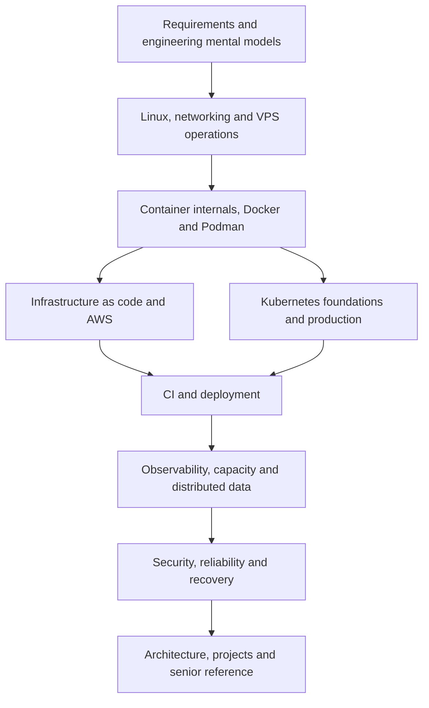

# The Complete DevOps Engineering Book

Read in order for the novice-to-production learning path. Experienced operators can use the [reference volume](volumes/22-operational-reference/README.md) and follow its links to deeper explanations.

The paths describe prerequisites for understanding, not a requirement that every company adopt every platform. The case-study volume compares organizations that choose different routes.

## Volumes

- [Volume 1 — Engineering Mental Models](volumes/01-engineering-mental-models/README.md)
- [Volume 2 — Linux and Automation](volumes/02-linux-and-automation/README.md)
- [Volume 3 — Networking and Traffic](volumes/03-networking-and-traffic/README.md)
- [Volume 4 — VPS and Server Operations](volumes/04-vps-and-server-operations/README.md)
- [Volume 5 — Container Internals and OCI](volumes/05-container-internals-and-oci/README.md)
- [Volume 6 — Docker in Practice](volumes/06-docker-in-practice/README.md)
- [Volume 7 — Podman and the Rootless Host](volumes/07-podman-and-the-rootless-host/README.md)
- [Volume 8 — Infrastructure as Code](volumes/08-infrastructure-as-code/README.md)
- [Volume 9 — AWS Foundations](volumes/09-aws-foundations/README.md)
- [Volume 10 — AWS Production Services](volumes/10-aws-production-services/README.md)
- [Volume 11 — Kubernetes Foundations](volumes/11-kubernetes-foundations/README.md)
- [Volume 12 — Kubernetes Production Engineering](volumes/12-kubernetes-production-engineering/README.md)
- [Volume 13 — Continuous Integration Platforms](volumes/13-continuous-integration-platforms/README.md)
- [Volume 14 — Delivery, Deployment and GitOps](volumes/14-delivery-deployment-and-gitops/README.md)
- [Volume 15 — Observability and Telemetry](volumes/15-observability-and-telemetry/README.md)
- [Volume 16 — Performance and Capacity Engineering](volumes/16-performance-and-capacity-engineering/README.md)
- [Volume 17 — Distributed Systems and Data Operations](volumes/17-distributed-systems-and-data-operations/README.md)
- [Volume 18 — Security and Software Supply Chains](volumes/18-security-and-software-supply-chains/README.md)
- [Volume 19 — Site Reliability and Recovery](volumes/19-site-reliability-and-recovery/README.md)
- [Volume 20 — Architecture and Platform Engineering](volumes/20-architecture-and-platform-engineering/README.md)
- [Volume 21 — Projects and Industry Case Studies](volumes/21-projects-and-industry-case-studies/README.md)
- [Volume 22 — Operational Reference](volumes/22-operational-reference/README.md)

## Reading paths

- Foundations: Volumes 1–4, followed by 5–7.
- Cloud operations: foundations, then 8–10, 13–19.
- Kubernetes operations: foundations and containers, then 11–19.
- Senior reference: Volumes 16–22, following prerequisite links when needed.
- Project journey: Volume 21 alongside the relevant explanatory chapters.

Draft and review status is maintained in [PROGRESS.md](../PROGRESS.md).
